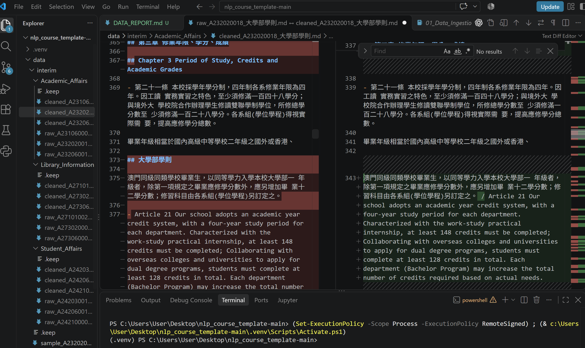
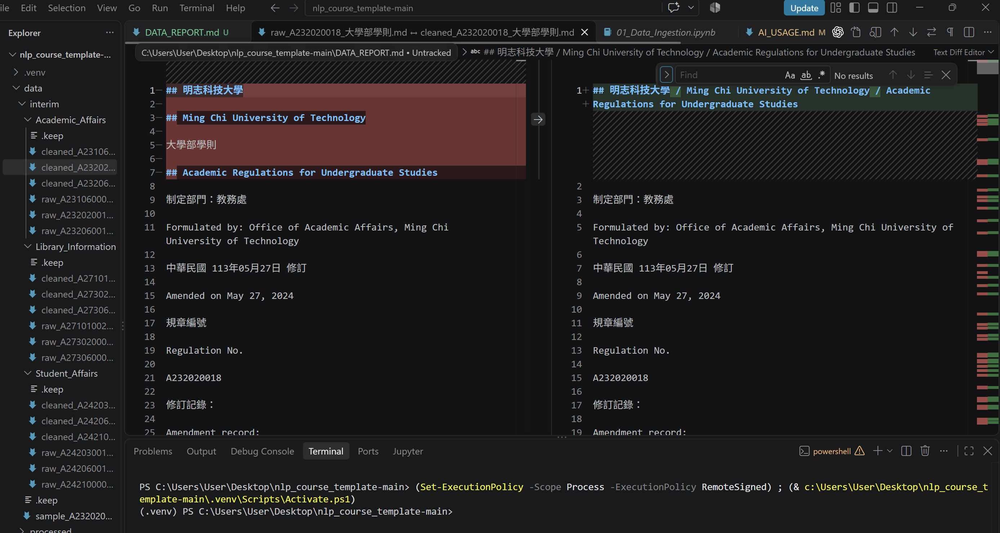
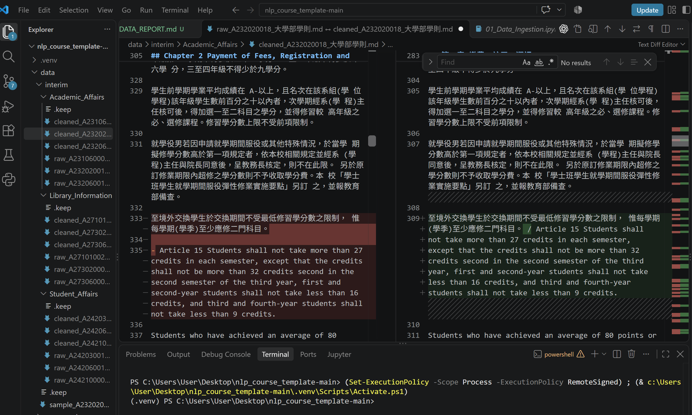
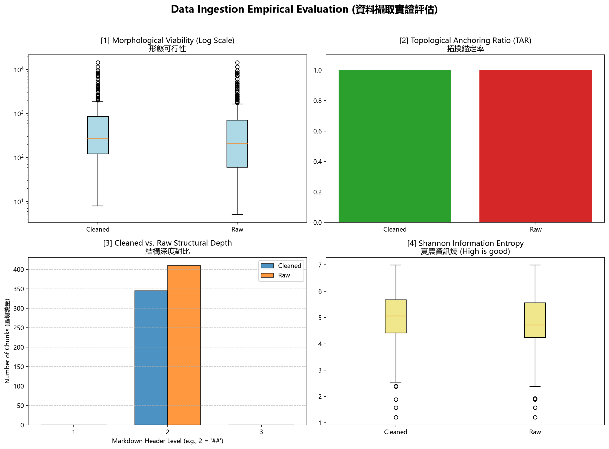

# 資料前處理報告 (Data Preparation Report)


- **學號 / 姓名**：U12627044/蕭宇辰
- **專案名稱**：nlp_course_template-main
- **完成的任務**：- [x] 1-A 頁首頁尾清除　- [x] 1-B 雙語標題合併　- [x] 1-C 雙語條文合併

---

## 1. 資料集概覽 (Dataset Overview)


| 類別 (Cluster) | PDF 數量 | 清洗前 chunk 數 | 清洗後 chunk 數 |
| Academic_Affairs | 3 | 96 | 65 |
| Library_Information | 3 | 248 | 225 |
| Student_Affairs | 3 | 66 | 55 |
| **合計** | 9 | 410 | 345 |

**問題 (2–3 句)：** 清洗後 chunk 數量變少了多少？是哪個任務造成的？有沒有哪個任務**不影響** chunk 數量？為什麼？


清洗後共有 345 個 chunk，比清洗前 410 個少 65 個。分階段統計，1-A 移除重複文件標題使數量減少 14 個，1-B 合併雙語 `##` 標題再減少 51 個；1-C 前後皆為 345 個，因為它不改動 `##` 標題切分邊界。

## 2. 清洗步驟 (Cleaning Steps)


### 2.1 任務 1-A：頁首頁尾溢出清除

- 檔名：`raw_A232020018_大學部學則.md`　搜尋的文字：`## 大學部學則`
- 截圖 (存為 `reports/figures/1a_compare.png`)：
- 改變了什麼：清除以 `## 大學部學則` 獨立出現的重複文件標題；此檔在 1-A 階段的 chunk 數由 43 降為 40。
- 這對之後的問答檢索有什麼幫助：降低重複標題在檢索結果中的干擾，讓命中的內容更集中在規定正文。
- 這個任務有沒有**改錯**的地方 (把不該改的也改了)？若有，寫出檔名與搜尋的文字；若沒有，寫「沒有發現」：檢查此檔的 7 個匹配處，都是獨立的文件標題行；抽查 raw/cleaned 差異未見其他正文被刪除。

### 2.2 任務 1-B：雙語標題合併

- 檔名：`raw_A232020018_大學部學則.md`　搜尋的文字：`Ming Chi University of Technology`
- 截圖 (存為 `reports/figures/1b_compare.png`)：
- 改變了什麼：把原本分開的中文、英文 `##` 標題合併在同一標題行；此例可看到校名雙語標題合併。
- 這對之後的問答檢索有什麼幫助：中文與英文校名同處一個標題，有利於兩種語言的查詢命中同一文件區段。
- 這個任務有沒有**改錯**的地方 (把不該改的也改了)？若有，寫出檔名與搜尋的文字；若沒有，寫「沒有發現」：發現疑似誤合併：`raw_A232060013_學生抵免學分辦法.md` 搜尋 `Article 4 Principles of Course Waiver and Credit Transfer`；其後的 `Principles of course waiver` 也是英文標題，卻被 1-B 合併，並非中英雙語標題。

### 2.3 任務 1-C：雙語條文合併

- 檔名：`raw_A232020018_大學部學則.md`　搜尋的文字：`Article 15`
- 截圖 (存為 `reports/figures/1c_compare.png`)：
- 改變了什麼：將 Article 15 英文條文與其前方中文條文合併在同一 chunk，保留雙語對照。
- 這對之後的問答檢索有什麼幫助：檢索到其中一種語言的條文時，同一 chunk 也包含另一語言版本。
- 這個任務有沒有**改錯**的地方 (把不該改的也改了)？若有，寫出檔名與搜尋的文字；若沒有，寫「沒有發現」：發現誤合併：`cleaned_A242100008_學生機車管理辦法.md` 搜尋 `insurance certificate, / and the payment receipt`；這是英文句子續行，不是中英條文。

## 3. 評估指標與 AI 解讀查證 (Metrics & Verifying the AI's Interpretation)

### 3.1 指標數據表


| 指標 | Raw | Cleaned (你的) | Cleaned (參考值) |
|---|---|---|---|
| [1] 中位數長度 Median Length | 205.0 | 273.0 | 273.0 |
| [2] 拓撲錨定率 TAR | 100% | 100% | 100% |
| [3] 深度變異量 SDV (選填) | 0.00 | 0.00 | 0.00 |
| [4] 中位數資訊熵 Entropy (選填) | 4.72 | 5.05 | 5.05 |




你的 Cleaned 結果與參考值一致嗎？若一致，寫「一致」；若不一致，找出原因。（1 句）

一致。

### 3.2 AI 的解讀


- 使用的 AI 工具：Codex

```text
整體來看，清洗後 chunk 的中位數長度由 Raw 的 205 增至 273（約增加 33.2%），中位數資訊熵由 4.72 增至 5.05；這表示 chunk 長度與字元分布都有變化。較長的 chunk 可能保留較完整的上下文，但也可能降低檢索定位的精細度；字元熵上升只代表字元分布較多樣，不能單獨證明語意品質提升。Raw 與 Cleaned 的 TAR 都是 100%，深度變異量都是 0，表示依目前程式的檢查方式，chunk 都有 Markdown 標題錨定，標題深度沒有變異；這些結構指標仍不能證明每次雙語合併都正確，或問答檢索一定更準。
```

### 3.3 你的查證 (至少兩點)


**查證 1**
- AI 的說法：Cleaned 的 chunk 中位數長度為 273，Raw 為 205，增加約 33.2%。
- 我查了什麼 (哪個檔案、哪個 chunk、哪段程式)：查看根目錄 `metrics.json` 的 `Morphology_Median_Length`，並核對 `notebooks/01_Data_Ingestion.ipynb` 第 6 節 `get_lengths()` 讀取 `metadata.char_length`、再以 `np.median()` 計算的程式。
- 結論：正確，因為 `metrics.json` 記錄 Cleaned = 273.0、Raw = 205.0；以 205 為基準增加約 33.2%。這只確認長度統計，不代表檢索品質必然提升。

**查證 2**
- AI 的說法：Raw 與 Cleaned 的 TAR 都是 100%、深度變異量 SDV 都是 0，表示所有 chunk 都通過程式的標題錨定檢查，且量到的標題深度一致。
- 我查了什麼：查看 `metrics.json` 的 `Topology_TAR_Score` 與 `Depth_Variance_SDV`，並核對 Notebook 第 6 節 `get_tar()` 的 `^\s*#+` 檢查，以及 `get_depths()` 計算開頭 `#` 數量後取變異數的程式。
- 結論：部分正確，因為指標數值支持「每個 chunk 開頭有 `#`，且量到的標題深度無變異」；但這些檢查只看 Markdown 標記與 `#` 數量，不能證明標題語意正確、雙語合併正確或檢索答案正確。

### 3.4 實際證據：你被指定的 chunk


- **SEED**：`1106`

**(a) 很長的 chunk**
- 資料檔 (JSON)：`data/processed/Academic_Affairs/cleaned_A232020018_大學部學則_processed.json`　位置：第 6 個 (從 0 開始數)　長度：7205 字元　驗證碼：`be3ddf35`
- 閱讀用檔案 (`.md`)：`data/interim/Academic_Affairs/cleaned_A232020018_大學部學則.md`　從第 283 行開始
- 前 3 行內容：
  ```text
  ## 第二章 繳費、註冊、選課 / Chapter 2 Payment of Fees, Registration and Course Selection

- 第十一條 學生應依規定日期辦理註冊。如因重病、特殊事故或因懷
  ```
- 這是什麼樣的文字？為什麼會這麼長？這是《大學部學則》第 2 章的條文內容；`##` 切塊規則會把標題到下一個標題前的內容保留為同一 chunk，因此此段有 7,205 字元。
- 之後做問答檢索時，這麼長的 chunk 可能造成什麼問題？單一 chunk 涵蓋多段規定，可能降低檢索定位精度，也可能讓回答帶入與問題無關的條文。

**(b) 資訊熵很低的 chunk**
- 資料檔 (JSON)：`data/processed/Library_Information/cleaned_A271010023_圖書館管理作業規範_processed.json`　位置：第 158 個 (從 0 開始數)　資訊熵：3.09　驗證碼：`bf740dca`
- 閱讀用檔案 (`.md`)：`data/interim/Library_Information/cleaned_A271010023_圖書館管理作業規範.md`　從第 1792 行開始
- 內容：
  ```text
  ## 總冊數：

總金額：
  ```
- 為什麼它的資訊熵這麼低？它對問答檢索有用嗎？這個 13 字元的 chunk 只有「總冊數／總金額」欄位標籤，字元種類少而沒有實質說明，因此資訊熵為 3.09；單獨作為問答依據的幫助有限。

## 4. 一個尚未解決的問題 (One Remaining Problem)

> 打開 `data/interim/` 中任一個 `cleaned_*.md` (與 `data/processed/` 的 JSON 內容相同，但有正常換行，比較好讀)，找出一個清洗後**仍然有問題**的 chunk。
> 每個 chunk 從一個 `## ` 標題開始，到下一個 `## ` 標題之前結束。
> 例如：只有標題沒有內文、表格亂掉、中英文沒有對齊、還有殘留的頁首頁尾、斷行造成的多餘空白，或是**清洗造成的錯誤** (誤合併、誤刪除)。
> **不可**使用第 3.4 節的兩個 chunk。

- **檔名** (`cleaned_*.md`)：`data/interim/Student_Affairs/cleaned_A242100008_學生機車管理辦法.md`　**從第 124 行開始** (VS Code 左側的行號)　**標題**：`## Article 2 Management Principles`
- **我是怎麼找到的** (例如：搜尋了什麼、看了哪個檔案)：在清洗後檔案搜尋 `insurance certificate, / and the payment receipt`，再回看同段條文。
- **問題 chunk (貼上部分內容)**：

```text
## Article 2 Management Principles

1. The "Motorcycle Parking Permit" is processed once per academic year. The motorcycle parking cleaning fee is 500 NTD per academic year. Students who apply for the "Motorcycle Parking Permit" in the second semester due to demand will be charged a cleaning fee of 300 NTD.
2. Motorcycle parking cleaning fee refunds are processed on a semester basis. A refund of half the fee, amounting to 250 NTD, can be granted. No refund will be provided after the second semester begins.
3. Applicants must prepare a copy of their campus card, driver's license, vehicle registration, insurance certificate, / and the payment receipt for the parking cleaning fee, and complete the "Motorcycle Parking Permit Application Form" for processing at the Student Discipline Division.
```

- **問題是什麼**：原文是英文句子在 `insurance certificate,` 後換行並以 `- and the payment receipt` 繼續；清洗後插入了表示雙語合併的斜線，造成不自然的句中分隔。
- **可能的原因** (PDF 本身？Docling 轉換？清洗的正則表示式？切塊規則？)：1-C 正則式只要求下一行以 `-` 和英文字母開頭，未確認前後是否為中英文條文，因此把一般英文續行誤判成雙語條文。
- **具體的修正方法** (例如：一條規則、一個正則表示式的構想、長度上限)：限制 1-C 只在前行含中文且後行符合 `- Article <編號>` 格式時合併；其他以連字號開頭的英文續行應接回原句並以空格連接，不插入斜線。
- **對問答檢索的影響**：斜線可能讓句子切分或關鍵詞比對變差，並降低英文問題命中完整申請文件清單的機會。

## 5. AI 協作 (AI Collaboration)

- 本次作業的 AI 協作紀錄請見 [`AI_USAGE.md`](AI_USAGE.md) 的「Week 04 / 08」與「Week 09」段落。
- 這次使用 AI 最大的收穫或教訓是 雖然AI是非常好用的工具，但自己若不去理解會導致自己不知道AI實際到底做了什麼，到最後連驗證都做不到，如AI可能給了錯誤資訊而自己看不懂無法去驗證，則之後會導致上交錯誤的結果。
